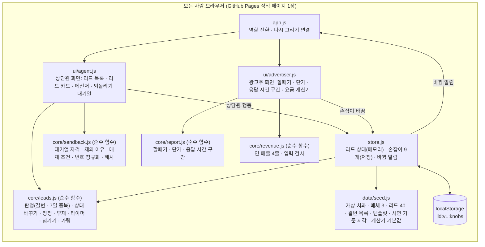
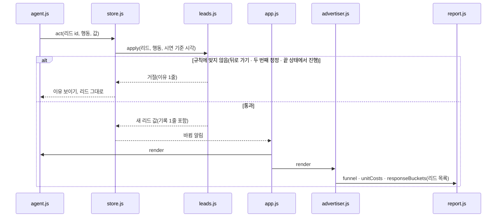

# 아키텍처

> 상태: 승인(사용자 "승인, 코드로", 2026-11-25) · 구현 반영 · 근거: [requirements.md](requirements.md)
> 데이터는 모두 가상이다. 서버 · 외부 API · 실제 메시지 발송 · 실제 매체 전송은 없다(ADR 0001).

## 1. 구성도



- 두 화면은 한 페이지 안에 함께 있다. 역할 버튼은 보이는 쪽만 바꾼다(AC-01).
- 두 화면은 같은 리드 목록 하나를 읽는다. 상담원이 상태를 바꾸면 광고주 리포트가 같은 규칙으로 다시 셈한다(A1 · AC-41).
- 리드 상태는 메모리에만 둔다. 새로고침하면 시연 시작 상태로 돌아간다. 계산기 손잡이 9개만 저장한다(ADR 0002).
- 시간 계산은 고정된 시연 기준 시각 하나로 한다(ADR 0004 · AC-23).

## 2. 구성요소 역할

| 구성요소 | 하는 일 | 하지 않는 일 |
|---|---|---|
| `core/leads.js` | 시작 판정(결번 · 7일 중복), 상태 다음 단계 · 끝 상태 · 정정 1번, 부재 횟수와 재연락 일정, 첫 응대 타이머(남은 분 · 주의 · 초과 · 미응대), 넘기기 1번, 전화번호 · 이름 가림 | 화면 그리기 · 저장 |
| `core/sendback.js` | 대기열 자격(내원 · 계약), 리드별 제외 이유(동의 · 28일 · 90일), 매체 조건(Meta 월 200건), 번호 정규화, SHA-256 해시(Web Crypto) | 외부 전송(하지 않음, AC-30) |
| `core/report.js` | 매체별 · 합계 깔때기 7칸, CPA · 유효 리드 단가 · 내원 단가(0건이면 없음), 응답 시간 구간 3개 · 내원율 | 화면 그리기 |
| `core/revenue.js` | 연 매출 4줄 · 합계, 손잡이 입력 검사(정수 · 허용 범위) | 저장 |
| `data/seed.js` | 고정 가상 데이터의 정본(AS-09 · AS-14). 바꾸지 않음 | 계산 |
| `store.js` | 시작 때 seed를 `leads.judge()`로 판정해 메모리에 둠. 상담원 행동을 `leads.js` 함수로 적용. 손잡이 9개 읽기 · 쓰기, 저장이 막히면 기본값 + 안내(AC-51). 바뀌면 등록된 함수를 부름 | 규칙 판단(규칙은 core가 함) |
| `ui/agent.js` | 리드 목록(타이머 · 상태 표시) · 고른 리드 카드(다음 단계 · 끝 상태 · 부재 · 템플릿 · 정정 · 넘기기) · 대화 기록 · 되돌리기 대기열 · 보관 안내 | 광고주 숫자 계산 |
| `ui/advertiser.js` | 깔때기 · 매체별 단가 표 · 응답 시간 구간 표 · 매체 발표 숫자 1줄 · 요금 계산기(손잡이 9칸 · 4줄 · 합계 · 되돌리기 · 가정 안내) | 리드 이름 · 번호 보이기(AC-02) |
| `ui/html.js` | 글자 이스케이프 · 원 단위 표기 | — |
| `app.js` | 역할 전환, 처음 그리기, store 바뀜 알림 → 두 화면 다시 그리기 | 계산 |

## 3. 호출 흐름

### 3-1. 처음 열 때

1. `store.init()`이 `seed.leads`를 복사해 `leads.judge()`로 결번 · 중복을 판정한다(AC-13 · AC-14).
2. `store`가 localStorage에서 손잡이 9개를 읽는다. 없거나 깨졌거나 읽을 수 없으면 `seed.defaultKnobs`를 쓴다.
3. 두 화면을 그린다. 처음 보이는 쪽은 '상담원'이고, 시연 사례 1 리드가 골라진 상태다.

### 3-2. 상담원이 리드 상태를 바꿀 때 (AC-08~22 · AC-41)



### 3-3. 되돌리기 대기열 (AC-24~30)

1. `agent.js`가 `sendback.queue(리드 목록, 시연 기준 시각)`를 부른다. 결과는 매체별로 '보낼 수 있음' 리드와 '빠진 리드 + 이유'와 매체 조건 줄이다.
2. 미리 보기 칸은 `sendback.hashPhone(번호, 매체)`의 64자 값만 보인다. 해시는 비동기(Web Crypto)라 그린 뒤 채운다.
3. '보내기'는 `store.act('sent')`로 기록 1줄만 남긴다. `fetch`는 없다.

### 3-4. 요금 계산기 (AC-44~51)

입력 → `revenue.validate(이름, 글자)` → 통과하면 `store.setKnob` → 저장 → 바뀜 알림 → 다시 그리기. 거절이면 바로 전 값 유지, 칸 옆 이유 1줄. 순서는 [flows.md](flows.md) F3.

## 4. 파일 배치

```
site/
  index.html             CSP 메타(같은 출처만) · 역할 버튼 · 두 화면 자리 · 가상 데이터 안내 1줄
  css/style.css          색 토큰(AC-52) · 375px 대응(AC-54)
  js/app.js
  js/store.js
  js/data/seed.js
  js/core/leads.js
  js/core/sendback.js
  js/core/report.js
  js/core/revenue.js
  js/ui/html.js
  js/ui/agent.js
  js/ui/advertiser.js
tests/
  leads.test.js          판정 · 상태 규칙 · 정정 · 부재 3번 · 타이머 · 넘기기 · 가림
  sendback.test.js       자격 · 제외 이유 · Meta 조건 · 해시 64자 · 원번호 0번
  report.test.js         시작 상태 단가 · 사례 1 뒤 666,667원 · 0건 '—' · 9칸 대조
  revenue.test.js        기본값 4줄 · 합계 · 입력 거절 · 되돌리기
  ui.test.js             화면 HTML 문자열 검사(광고주 화면 이름 · 번호 0개, 안내 줄, fetch 0개 등)
.github/workflows/pages.yml  검사 · 올리기 작업 → 배포 작업(needs로 분리)
```

- 시험: `node --test tests/`. 화면 함수는 HTML 문자열을 돌려주는 순수 함수로 만들어 Node에서도 시험한다. Node 20의 전역 `crypto.subtle`로 해시를 시험한다.
- 회사 이름 검사는 저장소 밖 지원 폴더의 스크립트로 한다(ADR 0003).

## 5. 품질 기준 연결

| 기준 | 어떻게 지키나 |
|---|---|
| 0.2초 안 다시 그리기(AC-41) | 리드 40건 · 매체 3개 계산. 서버 없음. 브라우저에서 시간 잼 |
| 금액 일치(AC-42) | 화면은 report 결과만 쓴다. 시험이 9칸을 따로 다시 셈해 대조 |
| 개인정보(AC-02 · 03 · 29 · 31) | 광고주 화면 그리기 함수는 리드 이름 · 번호 칸을 받지 않는다(집계만 넘김). 상담원 화면 번호는 가림 함수만 거쳐 나간다 |
| 외부 전송 0(AC-06 · 22 · 30) | `fetch` · 외부 스크립트 · 글꼴 · 분석 도구 없음. CSP `default-src 'self'` |
| 끝 조건 | 정정 1번 · 부재 3번 · 넘기기 1번을 상태 값에 기록하고 규칙 함수가 막는다([flows.md](flows.md) F5) |
| 글자 안전 | 정정 사유만 글자를 받는다. 길이 1~100자, 화면에는 이스케이프해서 넣는다 |
