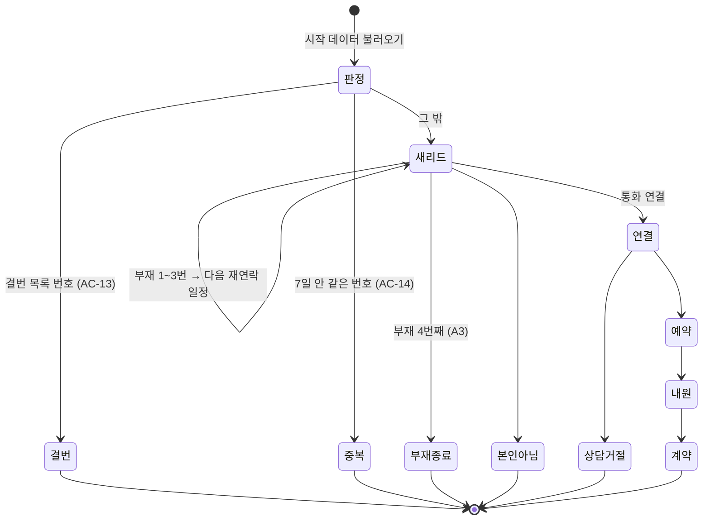
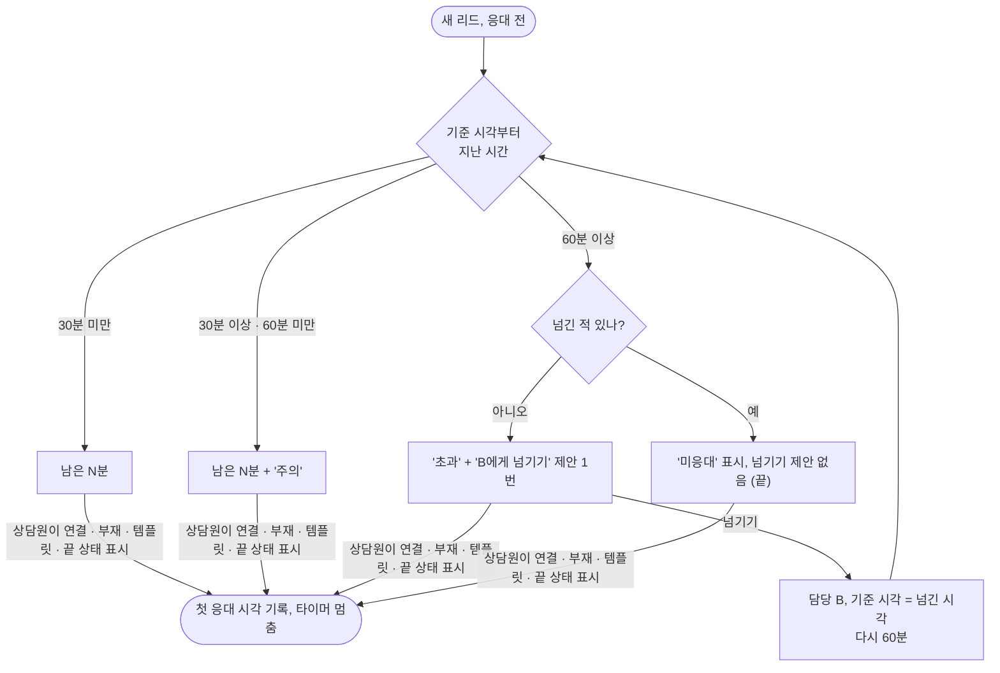
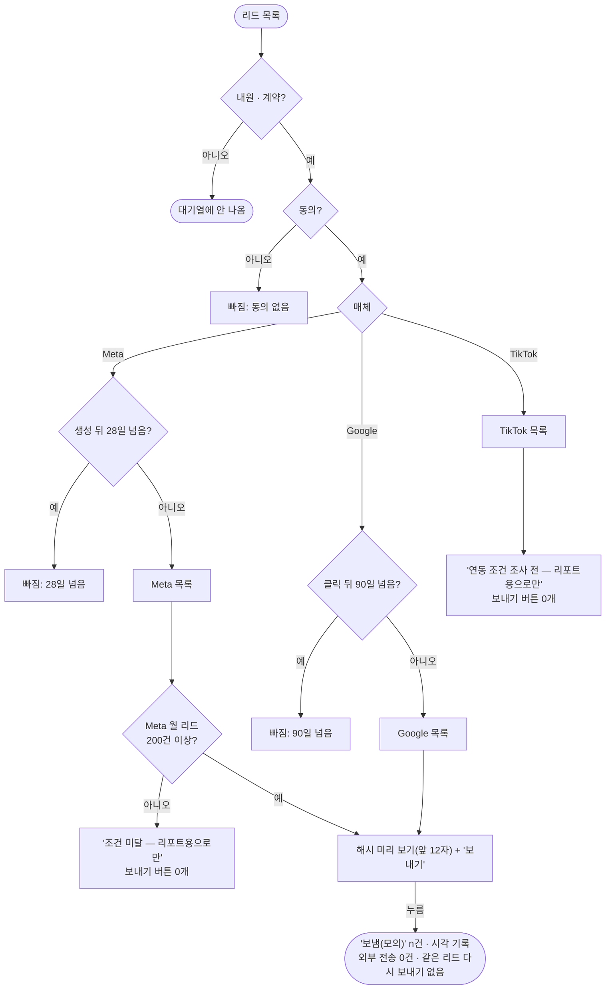
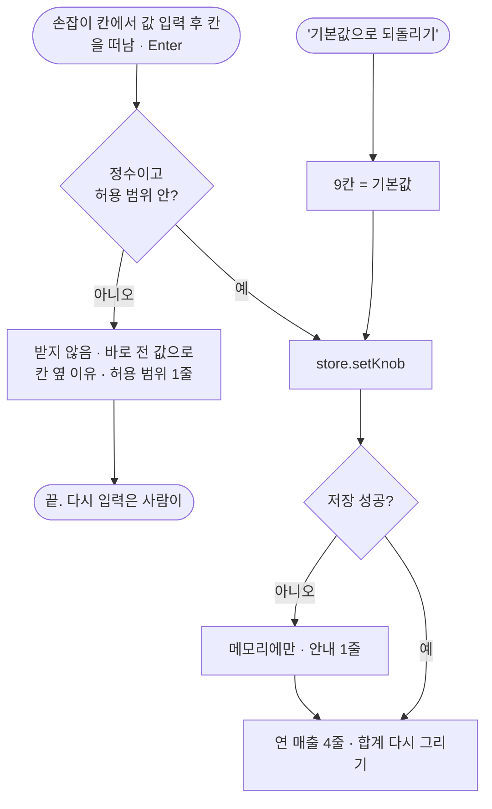

# 흐름 설계

> 상태: 승인(사용자 "승인, 코드로", 2026-11-25) · 구현 반영 · 근거: [requirements.md](requirements.md) · [data-model.md](data-model.md)

## F1. 리드 상태 (상담원, AC-08~21)

- 진행은 한 번에 바로 다음 단계 1칸만(AC-08). 앞선 단계로 가는 버튼은 없고, 규칙 함수도 거절한다(AC-09).
- **정정(1번만, AC-10 · 11):** 사유 1~100자를 넣으면 진행 단계는 바로 전 단계로, 사람이 표시한 끝 상태는 끝 상태를 지운다. 두 번째 정정은 거절하고 이유 1줄. 결번 · 중복은 정정 없음.
- 끝 상태 5개는 진행 버튼 0개(AC-12). 본인 아님 · 부재 종료도 유효 리드로 센다(AC-15).

## F2. 첫 응대 타이머 · 넘기기 (AC-18~21)

- 시간은 고정된 시연 기준 시각으로 센다(ADR 0004). 화면이 저절로 흐르지 않는다.
- '미응대' 리드도 상담원이 뒤늦게 응대할 수 있다. 응답 시간 구간은 '1시간 넘음'으로 옮겨 간다.

## F3. 부재 재연락 (AC-16 · 17, A3)

| 부재 표시 | 다음 일정 | 상태 |
|---|---|---|
| 1번째(첫 통화) | 당일 +2시간 | 새 리드(부재 1) |
| 2번째 | 다음 날 10:00 | 새 리드(부재 2) |
| 3번째 | 3일 뒤 10:00 | 새 리드(부재 3) |
| 4번째 | 없음 | 부재 종료(끝) |

- 재연락은 사람이 한다. 자동으로 다시 걸거나 메시지를 보내지 않는다.
- 부재 표시와 함께 '부재 안내' 템플릿을 고를 수 있다(보냄(모의) 기록만, AC-22).

## F4. 되돌리기 대기열 (AC-24~30)

- 이미 보낸 리드는 목록에 '보냄(모의)'으로 남고 다시 보낼 수 없다(되풀이 끝 조건).

## F5. 요금 계산기 (AC-44~51)

## F6. 시연 순서 (포트폴리오 · 면접용)

1. **상담원 화면:** 리드 목록에서 M01(남은 40분), T06('주의'), M20('초과' → B에게 넘기기), G11('미응대')을 보인다.
2. **사례 1:** M01 → '첫 안내' 템플릿(보냄(모의)) → 연결 → 예약 → 내원. 되돌리기 대기열에 M01이 Meta 목록으로 오르지만 "조건 미달 — 리포트용으로만". Google 목록은 G01 · G03 · G04 보낼 수 있음, G02는 "동의 없음".
3. **광고주로 바꿈 → 사례 2:** CPA는 Meta 100,000원이 가장 싸지만 내원 단가는 Google 500,000원이 가장 싸다. 사례 1 뒤 Meta 내원 단가는 666,667원으로 바뀌어 있다. 응답 시간 구간: 1시간 안 내원율이 1시간 넘음보다 높다.
4. **요금 계산기:** 기본값 연 384,000,000원 → 단독 고객 수를 바꾸면 4줄이 바뀐다. 잘못된 값(문자)을 넣으면 거절 1줄.
5. 새로고침하면 리드는 시작 상태, 계산기는 마지막 값으로 열린다.

## F7. 끝 조건 점검

| 되풀이될 수 있는 곳 | 끝나는 조건 |
|---|---|
| 부재 → 재연락 | 4번째 부재에서 부재 종료(A3) |
| 첫 응대 초과 → 넘기기 | 넘기기 1번. 다시 초과면 '미응대'로 끝 |
| 정정 | 리드마다 1번 |
| 되돌리기 보내기 | 리드마다 1번(보낸 뒤 버튼 없음) |
| 잘못된 입력 → 거절 | 한 번 거절하고 끝. 다시 입력은 사람이 함 |
| 저장 실패 | 한 번 안내하고 메모리로 계속. 재시도 없음 |
| 매체 조건 미달 | 안내 문구에서 끝. 다음 화면 없음 |
